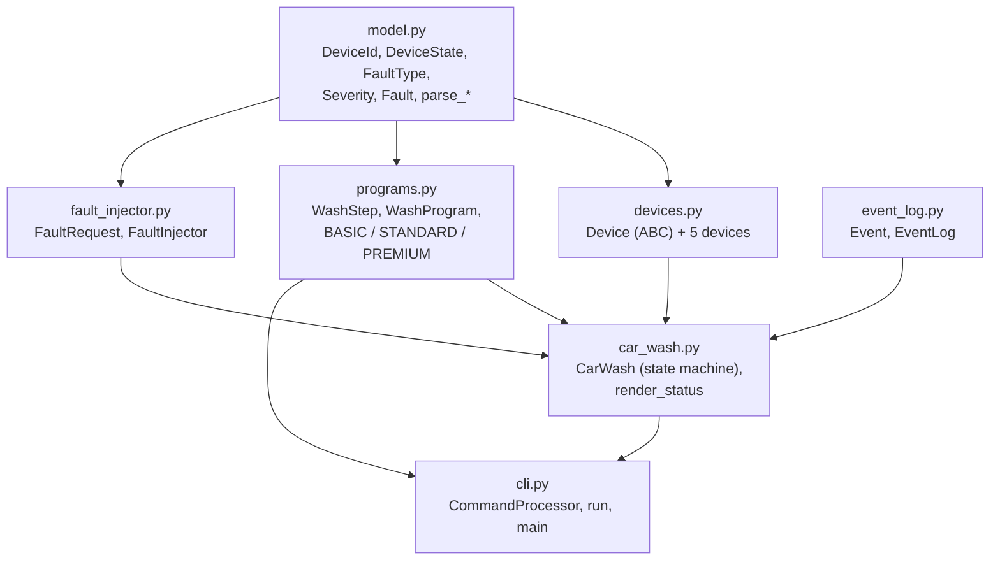
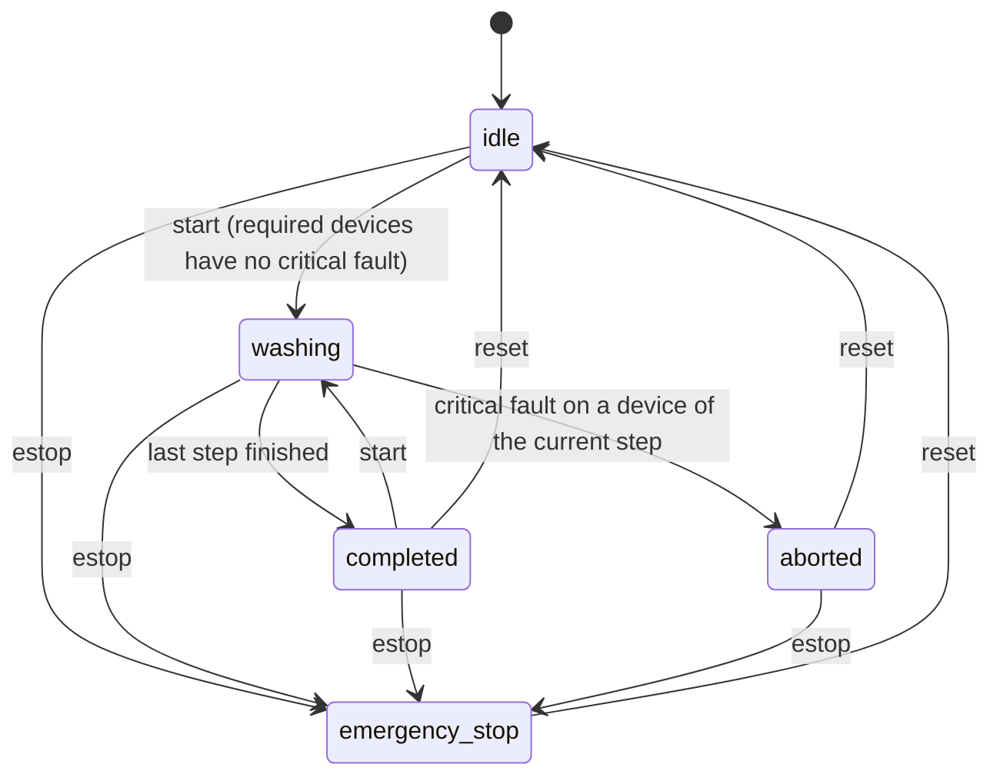
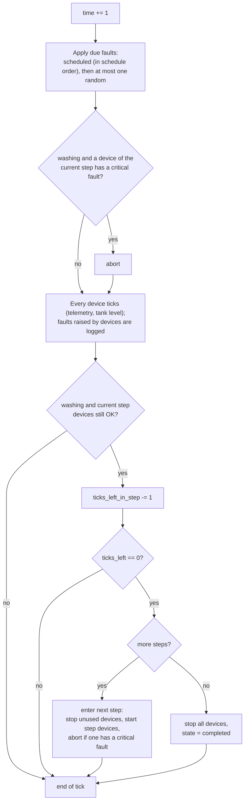

# Architecture

How the car wash emulator works inside. For usage see the [README](../README.md),
for scenario scripts see [scenarios.md](scenarios.md), for fault behaviour see
[fault-model.md](fault-model.md).

## Design principles

- **Deterministic, discrete time.** The simulation advances only when `CarWash.tick()`
  is called. No threads, no system clock. Random faults use a seeded `random.Random`,
  so the same commands and seed always give the same result.
- **Standard library only.** No runtime dependencies.
- **Layered modules.** Each module depends only on the ones above it, so the core can be
  tested without the CLI.

## Modules

| Module | Responsibility |
|---|---|
| `model.py` | Enums and value types; case-insensitive parsers with aliases (`chem`, `comm`, `crit`, ...); `default_severity()`. |
| `devices.py` | `Device` base class (start/stop, fault list, `tick()`, `telemetry()`) and five concrete devices with their own physics. |
| `programs.py` | Immutable wash programs as sequences of `WashStep(name, duration_ticks, devices)`. |
| `fault_injector.py` | Faults scheduled for a given tick plus an optional seeded random ("chaos") generator. |
| `event_log.py` | Append-only event list with an optional listener (the CLI prints events through it). |
| `car_wash.py` | `CarWash` controller: owns devices, injector and log; runs programs; aborts on critical faults. `render_status()` builds the `status` table. |
| `cli.py` | Text command interpreter, `expect` assertions, exit codes, `main()` entry point (`carwash`, `python -m carwash`). |

## Car wash state machine

- `start` is refused while `washing`, and in `aborted` / `emergency_stop` (reset first).
- `reset` is refused while `washing` (use `estop` first). **Reset does not clear faults.**
- `aborted_washes` is incremented by an abort and by `estop` during a wash.

## One tick

`CarWash.tick()` does the following, in this order:

Consequences worth knowing:

- A step of N ticks occupies ticks `start+1 .. start+N`. Program timelines are listed
  in [scenarios.md](scenarios.md#program-timelines).
- A fault due at tick `t` is applied **before** the step counter moves at `t`.
- A critical fault on a device that the current step does not use does **not** abort.
  The wash aborts when it enters the first step that needs that device, which can happen
  in the same tick if `t` is the last tick of the current step.
- Warnings never abort and never change step durations. They only degrade telemetry.
- Devices tick in every state, not only while washing (the dryer cools down, scheduled
  and random faults still arrive).

## Devices

All devices share the behaviour of `Device`:

- `state` is `fault` if the device has any critical fault, otherwise `running` or `idle`.
- `start()` fails (returns `False`) while a critical fault is present.
- Injecting a critical fault stops the device immediately.
- Injecting a fault type that is already present replaces its severity.
- `telemetry()` returns `n/a (no communication)` while `comm_lost` is present.

| Device | Telemetry | Physics |
|---|---|---|
| `pump` (`WaterPump`) | `pressure` | 80 bar running, 15 bar with `low_pressure`, 0 when stopped. |
| `chemicals` (`ChemicalDispenser`) | `level` | Starts at 100%, uses 5%/tick while running. Raises `low_level` by itself (see [fault-model.md](fault-model.md#self-raised-faults)). `refill` sets 100% and clears `low_level`. |
| `brushes` (`Brushes`) | `rpm` | 120 running, 40 with `blocked`, 0 when stopped. |
| `dryer` (`Dryer`) | `temp` | Heats by 10 °C/tick towards 60 °C (95 °C with `overheat`), cools by 5 °C/tick to 20 °C when idle. Shows `??` with `sensor_error`. |
| `conveyor` (`Conveyor`) | `speed` | 6 m/min running, 2 with `blocked`, 0 when stopped. |

## Wash programs

| Program | Ticks | Steps (ticks) | Chemicals used |
|---|---|---|---|
| `basic` | 9 | prewash 3, rinse 3, dry 3 | 0% |
| `standard` | 14 | prewash 2, foam 3, brushing 4, rinse 2, dry 3 | 15% |
| `premium` | 19 | prewash 2, foam 3, brushing 5, rinse 2, wax 2, dry 5 | 25% |

Devices per step: `prewash` and `rinse` use conveyor + pump, `foam` uses conveyor + chemicals,
`brushing` uses conveyor + brushes + pump, `wax` uses conveyor + chemicals + pump,
`dry` uses conveyor + dryer. The conveyor is needed by every step, so a critical
conveyor fault always aborts a running wash.

## CLI layer

- `CommandProcessor.execute()` handles one line: strips `#` comments, matches the
  command case-insensitively, and turns `CommandError` into `error: ...` output plus an error count.
- `run()` reads lines, attaches the event listener (unless `--quiet`), and computes the
  exit code (see [scenarios.md](scenarios.md#exit-codes)).
- `main()` parses `--script`, `--quiet`, `--echo`, `--version`. `--script` always echoes commands.

## Extending

- **New fault type**: add it to `FaultType` (and maybe an alias / `default_severity`),
  implement its effect in the device `_on_tick` / `_read_telemetry`, update
  [fault-model.md](fault-model.md), `HELP_TEXT` and README.
- **New device**: add a `DeviceId`, a `Device` subclass, register it in `CarWash.__init__`,
  use it in program steps.
- **New program**: add a `WashProgram` to `programs.py` and to `ALL_PROGRAMS`.
- Every change needs unit tests in `tests/` and, if visible from the CLI, a scenario.
