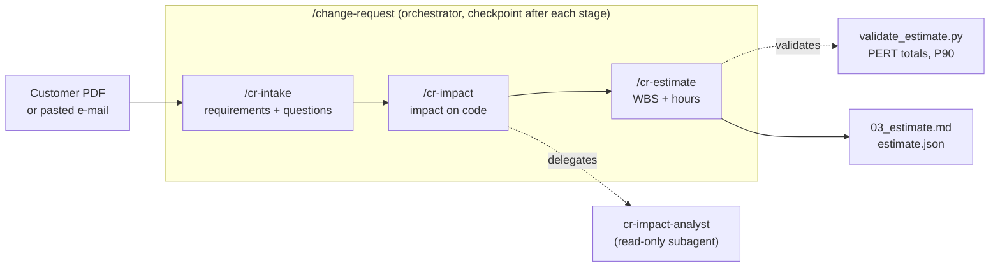

# Change requests

How customer change requests (CRs) are analysed and estimated with Claude Code.
The tooling is a set of project skills and one subagent in `.claude/`. It turns a
customer PDF or e-mail into numbered requirements, an impact analysis against this
codebase, and a work breakdown structure (WBS) with hour estimates.

Estimates are in **hours only**: three-point estimates per task, PERT expected value
and a P90. There are no story points, rates or costs.

## Quick start

```text
/change-request docs/customer/change_requests/inbox/spec_v2.pdf
```

or paste the e-mail text after the command:

```text
/change-request Hello, we would like the pump to report water usage ...
```

Claude creates `docs/customer/change_requests/CR-2026-001/`, runs the three stages and
stops after each one so you can review and correct the output before it continues.

## Flow



| Stage | Skill | Reads | Writes |
|---|---|---|---|
| 1. Intake | `/cr-intake <file or text>` | PDF / `.txt` / `.md` file, or pasted text | `source/`, `01_requirements.md`, `questions_for_client.md` |
| 2. Impact | `/cr-impact [CR-ID]` | `01_requirements.md`, the codebase | `02_impact.md`, new questions |
| 3. Estimate | `/cr-estimate [CR-ID]` | `01`, `02`, estimation model | `estimate.json`, `03_estimate.md` |
| All | `/change-request <file, text or CR-ID>` | | runs 1-3 with checkpoints |

Each stage skill can be run on its own. Without a CR ID, `/cr-impact` and
`/cr-estimate` use the most recent CR.

### 1. Intake (`/cr-intake`)

- Allocates the next ID `CR-<year>-<NNN>` and creates the CR folder.
- Stores the source unchanged in `source/` (a copy of the file, or the pasted text
  verbatim as `source/email.txt`).
- Reads the whole document (long PDFs page range by page range; scanned PDFs through
  OCR if the `pdf` skill is available).
- Splits the prose into atomic, testable requirements `REQ-01 ...`, each with a
  normalised statement, the source quote (in English) and its location, type
  (`functional`, `non-functional`, `documentation`, `constraint`) and MoSCoW priority.
- Maps the client's terms to project terms (glossary) and checks each requirement
  against the rules in `CLAUDE.md` (standard library only, determinism, Python 3.10,
  strict typing).
- Writes ambiguities, missing values and conflicts as questions `Q-01 ...`.

All output is in English. Quotes from a source in another language are translated and
marked `(translated)`. Only `source/` keeps the original wording.

### 2. Impact analysis (`/cr-impact`)

- Delegates the code reading to the `cr-impact-analyst` subagent (read-only: Read,
  Grep, Glob), split into parallel groups for large CRs.
- For each requirement: matching change pattern, affected modules and symbols (in
  layer order), unit tests, new and possibly broken scenarios, docs to update, rule
  check, complexity notes.
- Spot-checks the subagent's file and symbol references before writing `02_impact.md`.
- Appends questions that only show up in the code.

### 3. Estimate (`/cr-estimate`)

- Builds the WBS: `1` = CR, `1.N` = work package per requirement (or group of
  tightly coupled requirements), `1.N.M` = task. The last work package is always
  *Integration and delivery*.
- Gives every task optimistic / most likely / pessimistic hours, starting from the
  building blocks in the estimation model, and records the block and any adjustment
  in `basis`.
- Writes `estimate.json`, validates it with
  `.claude/skills/cr-estimate/scripts/validate_estimate.py` and pastes the script's
  Markdown output (WBS table, effort by category, totals) into `03_estimate.md`.
  Claude never adds up hours by hand.
- Re-running keeps the previous version as `03_estimate.v<n>.md`.

## Output files

```
docs/customer/change_requests/
  CR-2026-001/
    source/                   original PDF or email.txt, never edited
    01_requirements.md        requirements, glossary, rule conflicts, out-of-scope candidates
    questions_for_client.md   open questions + an Answers section
    02_impact.md              impact per requirement, cross-cutting effects
    estimate.json             WBS with O/M/P hours (machine-readable)
    03_estimate.md            client-ready estimate in Markdown
    03_estimate.v<n>.md       previous estimate versions
```

The CR folders are versioned in git, so the history of requirements and estimates is kept
with the code they refer to. Commit them like any other documentation change.

## Estimation model

The model lives in
[`.claude/skills/cr-estimate/references/estimation-model.md`](../.claude/skills/cr-estimate/references/estimation-model.md):

- **Building blocks** with baseline O/M/P hours for this codebase, e.g. `I2` *fault
  effect in one device*, `I3` *new device*, `T3` *new scenario*, `R1` *quality gate*.
- **Change patterns** (new fault type, new device, new program, new CLI command,
  state machine change, ...) listing the blocks they need, so every Definition-of-Done
  item from `CLAUDE.md` (unit tests, scenario, README, docs, `/check`) is in the WBS.
- **Adjustment rules**: ambiguity widens P rather than M, reuse lowers M, project rule
  conflicts are never estimated silently, tasks between 0.1 h and 8 h.

Formulas, computed by the script:

| Value | Formula |
|---|---|
| Task expected hours | `E = (O + 4M + P) / 6` |
| Task standard deviation | `(P - O) / 6` |
| CR expected hours (~P50) | sum of task `E` |
| Work package standard deviation | sum of its task standard deviations (tasks of one package are fully correlated) |
| CR standard deviation | `sqrt(sum of work package SD^2)` (work packages are independent) |
| P90 | `E + 1.2816 * SD` |

Treating tasks in one work package as correlated reflects that they usually depend on the
same requirement and the same open questions. A single client answer moves all of them
together. Treating all tasks as independent would let their uncertainties cancel out and
make the P90 unrealistically close to the expected value.

To tune the estimates, edit the building block values in the model file. The skill
reads the current version on every run.

### `estimate.json`

See [`templates/estimate.example.json`](../.claude/skills/cr-estimate/templates/estimate.example.json).
The validator checks:

- `cr_id` is `CR-YYYY-NNN`, `unit` is `hours`, requirement IDs are `REQ-NN`;
- work package IDs are `1.N`, task IDs are `1.N.M` and belong to their package, and all IDs are unique;
- `category` is one of `analysis`, `implementation`, `unit-tests`, `scenario-tests`,
  `documentation`, `review`;
- hours are numbers with `0 <= O <= M <= P` and `P > 0`;
- every in-scope requirement is covered by a work package, and no work package
  references an out-of-scope one (`"in_scope": false`).

Run it by hand:

```bash
.venv/Scripts/python.exe .claude/skills/cr-estimate/scripts/validate_estimate.py \
    docs/customer/change_requests/CR-2026-001/estimate.json --markdown
```

Exit codes: `0` valid, `1` invalid estimate (errors on stderr), `2` unreadable file or JSON.
The script uses the standard library only. It is type-checked by `mypy` and tested in
`tests/test_validate_estimate.py`.

## Typical workflows

**New request.** `/change-request <pdf or text>`, review and correct
`01_requirements.md` at the first checkpoint (this has the largest effect on the
result), then let it run impact and estimate. Send `03_estimate.md` and
`questions_for_client.md` to the client.

**Client answered questions.** Fill in the Answers section of
`questions_for_client.md`, then run `/cr-impact CR-2026-001` and
`/cr-estimate CR-2026-001`. The new estimate gets a new version; the old one is kept.

**Manual correction of the estimate.** Edit `estimate.json`, then ask Claude to run
`/cr-estimate` again, or run the validator with `--markdown` yourself and paste the
output into `03_estimate.md`.

## Files of the tooling

```
.claude/
  agents/cr-impact-analyst.md               read-only impact subagent
  skills/change-request/SKILL.md            orchestrator
  skills/cr-intake/SKILL.md                 + templates/requirements.md, questions.md
  skills/cr-impact/SKILL.md                 + templates/impact.md
  skills/cr-estimate/SKILL.md               + templates/estimate.md, estimate.example.json
  skills/cr-estimate/references/estimation-model.md
  skills/cr-estimate/scripts/validate_estimate.py
tests/test_validate_estimate.py
```

## Limitations

- E-mail input is pasted text. `.eml` / `.msg` files are not parsed.
- Estimates assume one developer who knows the codebase. The building block values
  are starting values and should be tuned by hand when actual effort differs.
- The flow ends at the estimate. It does not create branches or code.
